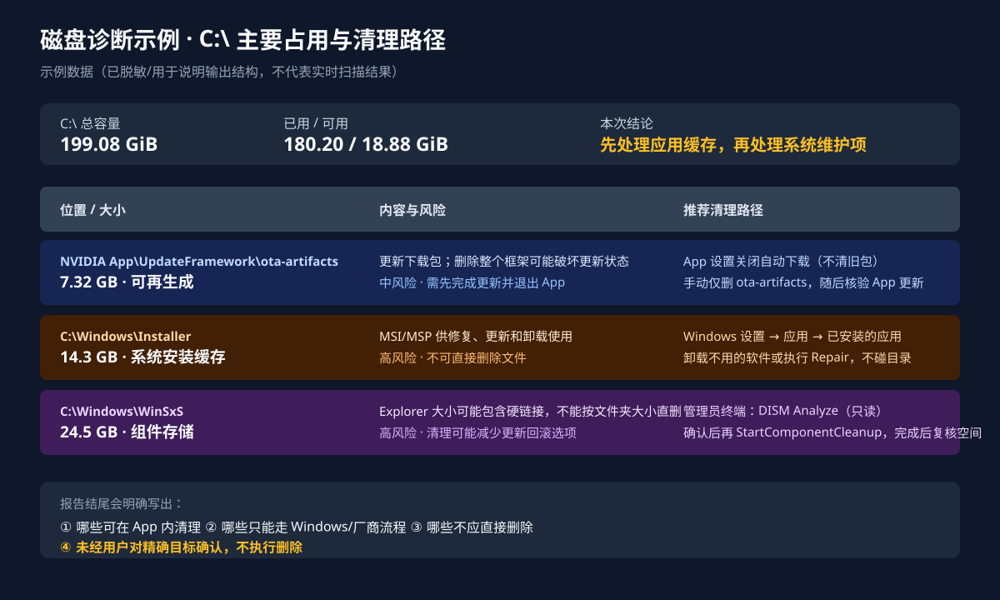

# Codex Skills Collection

一组可复用的 Codex 技能，覆盖旅行规划、Windows 磁盘诊断和文档润色。每个技能都可以独立使用，并在对应目录中维护自己的说明和配套资源。

## 技能目录

| 领域 | 技能 | 用途 |
| --- | --- | --- |
| Travel · 旅行 | [attraction-itinerary-excel](skills/travel/attraction-itinerary-excel/SKILL.md) | 从行程截图或文档提取地点，核验票务、开放时间和预约方式，生成包含人民币估算和来源链接的 Excel。 |
| Travel · 旅行 | [map-itinerary-visualizer](skills/travel/map-itinerary-visualizer/SKILL.md) | 定位行程地点，按日期规划访问顺序，生成带编号、路线箭头和图例的地图图片。 |
| System · 系统 | [disk-space-diagnosis](skills/system/disk-space-diagnosis/SKILL.md) | 只读分析 Windows 磁盘占用，解释大项用途、清理风险和可行的优化路径，不默认执行清理。 |
| Writing · 写作 | [document-refinement](skills/writing/document-refinement/SKILL.md) | 润色中英文邮件、报告和方案，保留原意与修改边界，减少空话和写作过程旁白，逐步补全缺失内容。 |

## 快速开始

### 选择技能

打开上表中的 `SKILL.md`，确认用途和所需工具，然后复制对应的**整个技能文件夹**。例如，文档润色技能位于 `skills/writing/document-refinement/`。

保留文件夹中的 `agents/`、`references/`、`scripts/` 等配套内容，不要只复制 `SKILL.md`。如果目标目录已有同名技能，先比较两份内容，再决定是否覆盖本地修改。

### 放入技能加载目录

按使用范围选择位置：

- **个人使用**：放入 `~/.agents/skills/`，供不同项目使用。`~` 表示当前用户的主目录。
- **项目使用**：放入目标项目的 `.agents/skills/`，随项目一起维护。

技能文件夹应直接放在加载目录下，不保留本仓库的领域分类层。例如，个人安装后的入口为 `~/.agents/skills/document-refinement/SKILL.md`。目录规则见 [Codex 官方技能文档](https://learn.chatgpt.com/docs/build-skills#where-codex-loads-local-skills)。

### 在任务中调用

选择技能，并附上需要处理的文件、截图或路径：

```text
$document-refinement 帮我润色这份文档，尽量保留原文。暂不修改的部分保持不变，缺失信息先留 [TBD]。
```

Codex 可以按任务自动匹配技能，也可以显式指定技能。如果新技能没有立即出现，可以重启后再检查。具体调用方式见[官方说明](https://learn.chatgpt.com/docs/build-skills#how-chatgpt-and-codex-use-skills)。

## 调用示例

每条示例对应一个独立任务；旅行任务还应同时提供行程和出行日期。

```text
$attraction-itinerary-excel 按这份行程逐条整理地点，核实门票、开放时间和预约方式，生成 Excel，不增删原行程项目。

$map-itinerary-visualizer 把这份行程按日期画在地图上，标出地点编号和建议路线，并说明调整顺序的原因。

$disk-space-diagnosis 帮我分析 C 盘为什么快满了，解释主要占用项和清理风险，只做诊断，不删除或修改文件。
```

## 磁盘诊断示例：从占用分析到清理路径

如果希望得到可执行但不自动删除的分析，可以这样提问：

```text
$disk-space-diagnosis 仔细检查 C 盘，列出所有主要占用项。对每一项说明它是什么、为什么会变大、能否清理、预计可释放多少空间，并给出应用内的具体删除入口；如果应用里没有清理按钮，请给出安全的手动步骤。不要直接删除，先等我确认。
```

预期结果不只是目录大小，而是把每个候选项连到具体处理路径：

| 结果类型 | 输出应包含 |
| --- | --- |
| 应用缓存或更新包 | 所属应用、当前版本（如可查）、应用内菜单路径；并说明“关闭自动下载”不会自动删除已有文件。 |
| Windows 或厂商维护项 | Windows 设置、厂商工具或管理员命令的准确入口，以及是否需要退出应用、管理员权限或重启。 |
| 没有应用内入口 | 明确说明“应用内没有清理按钮”，再给出精确到子目录的手动步骤，不扩大到整个父目录。 |
| 不应直接删除的项目 | 解释依赖关系和潜在后果，并给出替代方案，例如卸载不用的软件、Repair 或 DISM 只读分析。 |

下面是脱敏示意图，不代表实时扫描结果：



完整报告还应说明清理前置条件、预计释放空间、风险等级和清理后的验证方式。只有用户确认精确目标后，才执行删除或系统维护操作。

## 所需工具与使用边界

复制技能只会添加工作指引，不会自动安装依赖工具。各技能的具体要求以对应的 `SKILL.md` 为准。

- **行程 Excel**：需要联网查询；当前指引还要求表格技能和 `@oai/artifact-tool`，用于生成和检查工作簿。票价、汇率和开放时间应按出行日期核验，估算值与无法核实的信息需明确标注。
- **行程地图**：需要地图访问、截图和图片处理能力。无法取得真实地图时，替代示意图必须明确标注，不能当作地图截图交付。
- **磁盘诊断**：面向 Windows，需要 PowerShell 等只读查询能力。诊断不包含删除文件或调整系统设置；后续操作须单独确认精确目标和风险。
- **文档润色**：日常文字修改无需运行脚本；可选的核对和提取脚本使用 Python 3.10+ 标准库。脚本可以核对文本和修改范围，但不能证明事实正确；Word/PDF 排版、OCR 和渲染检查需要相应工具。

## 维护与验证

新增技能按 `skills/<领域>/<技能名>/` 放置，并在上方目录中补充链接和用途。入口使用 `SKILL.md`；有配套资源时，保持相对引用可用。分享前检查是否包含个人路径、凭据或敏感样例。

修改文档润色技能的脚本后，可在仓库根目录运行回归测试：

```shell
python -B skills/writing/document-refinement/scripts/test_document_audit.py
```

该测试只覆盖文档核对和提取脚本，不代表其他技能已经通过测试，也不能替代实际产物检查。
